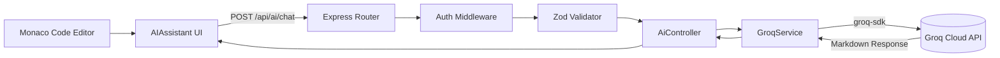

# AlgoTrack Architecture Documentation

## Overview

AlgoTrack is a full-stack algorithmic learning, practice tracking, and AI tutoring platform. The platform is organized into a clean monorepo architecture with a React single-page frontend, a Node.js/Express REST backend, and Supabase PostgreSQL for persistence and authentication.

---

## 1. Monorepo Structure

```text
AlgoTrack/
├── frontend/                     # Client application (Vite + React + TypeScript)
│   ├── public/                   # Static assets & icons
│   ├── src/
│   │   ├── components/
│   │   │   ├── auth/             # Login, Register, ProtectedRoute
│   │   │   ├── common/           # Reusable UI primitives (Button, Modal, Toast)
│   │   │   ├── dashboard/        # Progress tracker, pattern analytics
│   │   │   ├── layout/           # AppLayout, Navbar, Footer
│   │   │   ├── problems/         # Problem library, search, and pattern filters
│   │   │   └── workspace/        # MonacoCodeEditor, AIAssistant
│   │   ├── context/              # AuthContext (Supabase Auth)
│   │   ├── pages/                # Route entrypoints
│   │   └── services/             # API client services (aiService, problemService)
│   ├── package.json
│   └── vite.config.ts
│
├── backend/                      # Server application (Node.js + Express + TypeScript)
│   ├── src/
│   │   ├── config/               # Environment (env.ts), Supabase (supabase.ts)
│   │   ├── controllers/          # Request handlers (ai, problems, workspace)
│   │   ├── middleware/           # auth.middleware, error.middleware, rateLimiters
│   │   ├── routes/               # API routes (/api/ai, /api/problems, /api/workspace)
│   │   ├── services/             # Business logic (GroqService, ProblemService)
│   │   ├── utils/                # ApiError, ApiResponse
│   │   ├── validators/           # Zod schema validation (ai.validator.ts)
│   │   └── app.ts                # Express app initialization
│   ├── .env                      # Server secrets (GROQ_API_KEY, SUPABASE_SERVICE_ROLE_KEY)
│   └── package.json
│
├── docs/                         # System documentation
│   ├── API.md                    # REST endpoint specifications
│   └── ARCHITECTURE.md           # Architecture and technical design
│
└── supabase/                     # Database migrations and full SQL schemas
    ├── full_schema.sql
    └── migrations/
```

---

## 2. Groq AI Integration Architecture

In Phase 6, raw remote code execution (Judge0 / RapidAPI) was decommissioned in favor of an AI-powered static code review and tutoring workflow powered by the **Groq API**.

### AI Request Flow



1. **Frontend Workspace (`AIAssistant.tsx`)**:
   - Collects user code directly from the Monaco Editor instance, along with problem context (title, description, tags, active language).
   - Provides 7 dedicated Quick Action shortcuts (*Analyze My Code*, *Explain My Code*, *Find Logical Errors*, *Review Edge Cases*, *Time & Space Complexity*, *Give Me a Hint*, *Optimize My Approach*) as well as freeform user chat.
   - Dispatches requests via `src/services/aiService.ts` to `POST /api/ai/chat`.

2. **Backend Security Layer (`backend/src/routes/ai.routes.ts`)**:
   - Routes requests through `authenticateOptional` or `authenticate` middleware.
   - Enforces request validation using Zod (`aiChatSchema` in `ai.validator.ts`).
   - Keeps `GROQ_API_KEY` strictly server-side inside `backend/.env`. The frontend never accesses or stores third-party LLM API keys.

3. **Groq Service Layer (`backend/src/services/groq.service.ts`)**:
   - Uses `groq-sdk` with default model `llama-3.3-70b-versatile` (configurable via `GROQ_MODEL`).
   - Injects a strict algorithmic tutor system prompt instructing the model to perform static analysis, point out off-by-one errors and edge cases, evaluate asymptotic Big-O bounds, and provide Socratic guidance without hallucinating code execution.
   - Gracefully handles missing API keys by returning helpful configuration instructions instead of 500 crashes.

---

## 3. Practice Philosophy & Separation of Concerns

- **Code Editing**: Full Monaco Editor with multi-language syntax highlighting (Python, JavaScript, TypeScript, Java, C++).
- **Execution & Validation**: Delegated to official coding platforms (LeetCode). Users copy their code with one click and run it against LeetCode's comprehensive test suite.
- **Learning & Revision**: AlgoTrack persists personal approaches, time & space complexities, edge cases, and personal notes per problem in Supabase PostgreSQL, creating an enduring interview prep knowledge base.

